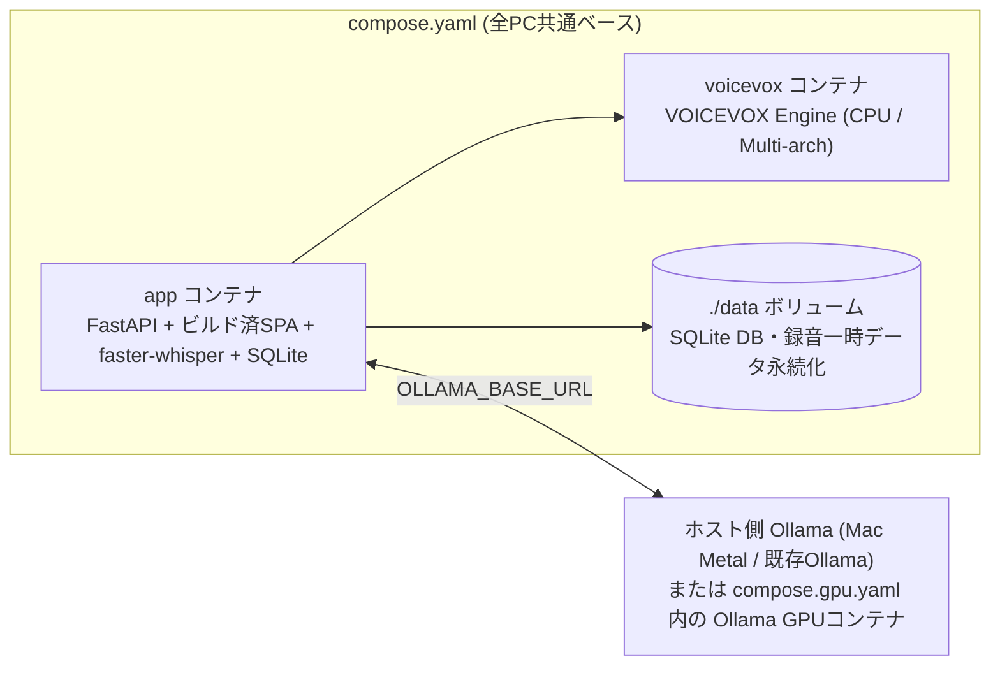
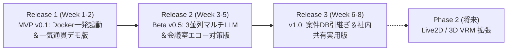

# AI会議ファシリテーターシステム 開発計画書（MVP先行・Docker対応版）

## 1. プロジェクト概要と開発アプローチ

### 1.1 背景と目的
対面会議室のテーブル上に設置したマイクスピーカーとモニターを介し、会議に同席する**完全ローカル完結型のAI会議支援Webシステム**を構築する。
最終的にはNVIDIA GB10（128GB ユニファイドメモリ / Linux `aarch64`）上で複数のローカルLLM（`Llama 3.1` / `Qwen 2.5` / `Gemma 2`）と並列AIエージェントを稼働させるが、**Docker Composeによるコンテナ構成**を採用することで、開発用のMacや検証用の別PCでもコマンド1つで同一環境を再現・実行できるようにする。

### 1.2 開発手法：MVP先行型（Vertical Slice アプローチ）
下回りの基盤だけを長期間作るのではなく、**最初の2週間で「一通りの会議体験が動くMVP（Minimum Viable Product）」を完成させて関係者に実演（デモ）し**、実際の使用感やフィードバックを取り込みながら段階的にマルチLLM化・高機能化を進める。

* **開発体制**：1名（フルスタック個人開発 ＋ AIコーディング支援）
* **目標期間**：全8週間（3段階のマイルストーンリリース：`MVP v0.1` → `Beta v0.5` → `実用版 v1.0`）

### 1.3 スコープ定義

| 区分 | 対象項目 |
| :--- | :--- |
| **In-Scope（8週間）** | ・**Docker Compose化**：Mac / 一般Linux・Windows PC / GB10 (`arm64`) のどのPCでも簡単に起動できる構成 ・**簡易パスワード認証**：社内LANアクセス時の共有パスコード保護 ・**対面会議室対応**：単一マイクスピーカー＋モニター同席、連続音声認識、自己音声エコー抑止 ・**マルチLLM並列エージェント**：`Llama 3.1` / `Qwen 2.5` / `Gemma 2` のメモリ常駐と3役並列協調 ・**案件DB・引き継ぎ**：SQLiteによる議事録保存と、未決定事項・素材待ちの次回会議への自動引き継ぎ ・**動画＋音声対話UI**：ループ動画切替（MP4）＋ローカル音声合成（VOICEVOX） |
| **Phase 2（将来拡張）** | ・`AvatarRenderer` 抽象インターフェースを介した Live2D / 3Dアバター（VRM）および波形リップシンクへの差し替え |
| **Out-of-Scope（対象外）** | ・オンライン会議（Zoom / Teams等）連携、声紋による個人別話者特定、ロボット実機連携（※別案件として分離） |

---

## 2. Dockerポータビリティ設計（どのPCでも簡単に動かす仕組み）

OSやCPUアーキテクチャ（MacのApple Silicon `arm64`、一般PCの `amd64`、GB10のLinux `arm64`）の違いを吸収するため、**マルチアーキテクチャ対応のベースイメージ**を採用し、GPU有無をプロファイル／オーバーライドで切り替える。

| 実行するPC環境 | 起動コマンドイメージ | 動作の仕組み |
| :--- | :--- | :--- |
| **手元のMac / 一般開発PC** | `docker compose up --build` | アプリとVOICEVOXがコンテナ起動。ホスト側にOllamaがあればMacのGPUを自動利用（未導入PCでも内蔵モックまたはCPUコンテナで即デモ可能） |
| **本番 GB10 (Linux + Blackwell)** | `docker compose -f compose.yaml -f compose.gpu.yaml up -d` | NVIDIA Container Toolkit経由で `faster-whisper` や `Ollama`（またはGB10ホスト上の既存Ollama）が128GB GPUメモリをフル活用して高速稼働 |

---

## 3. 採用モデル構成とGB10メモリ配分計画

Ollamaの環境変数（`OLLAMA_MAX_LOADED_MODELS=4`, `OLLAMA_KEEP_ALIVE=-1`）により、以下3系統のモデルを同時常駐させる。

| 役割 | 第1候補モデル | 選定理由 | 推定メモリ (GB10) |
| :--- | :--- | :--- | :--- |
| **進行役（Facilitator）** | `llama3.1:8b` (または `gemma2:9b`) | 低遅延（発話までの待ち時間最小化）・自然な口語応答 | 約 7〜9 GB |
| **書記役（Scribe）** | `qwen2.5:14b` | 日本語の文脈整理と4分類JSONスキーマ出力の安定性が高い | 約 12 GB |
| **監査・まとめ役（Auditor / Summarizer）** | `qwen2.5:32b` (比較候補: `gemma2:27b` / `llama3.1:70b`) | 長文ログからの論点抜け漏れ検知・最終要約の網羅性が高い | 約 22〜45 GB |
| **音声AI・アプリ基盤** | `faster-whisper` + `Silero VAD` + `VOICEVOX` + `FastAPI` | 常時待機プロセス一式 | 約 15 GB |
| **合計目安** | **3モデル＋音声AIすべて同時メモリ常駐** | **128GB中 約56〜81GB使用（十分な空きメモリを確保）** | — |

> [!NOTE]
> スペックの低い別PCでDocker起動して動作確認する際は、`.env`（環境変数）で全エージェントのモデルを軽量な `llama3.1:8b` 1つに統一するだけで、メモリ16GBクラスのPCでも同じコードのまま動作します。

---

## 4. MVP先行型 開発ロードマップ（全8週間・3段階リリース）

### 各リリースのゴールと週次WBS

| 段階・週 | マイルストーン目標（「何を見せられる状態にするか」） | 主な実装タスク |
| :--- | :--- | :--- |
| **Week 1** *(MVP v0.1)* | **Docker基盤 ＋ 画面・DB・簡易認証の骨格完成** どのPCでも `docker compose up` でログイン画面と議事ボードが開く | ・`Dockerfile` / `compose.yaml` 作成（FastAPI + Vite+TS + SQLite + VOICEVOX） ・簡易パスワード認証（パスコード入力→セッション発行）実装 ・単一LLM（`Llama 3.1`）での4分類ボード更新＆Markdown保存 |
| **Week 2** *(MVP v0.1)* | **★初回デモ公開（MVP v0.1 完成）** 声で録音→ボード整理→動画アバターがVOICEVOXの声で進行・まとめを行う一連の流れを実演できる | ・ボタン録音（または簡易区間録音）＋ `faster-whisper` 文字起こし連携 ・`VOICEVOX` 音声合成 ＋ ループ動画（`idle` / `thinking` / `speaking`）切替実装 ・**★社内お披露目デモ実施・初期フィードバック収集** |
| **Week 3** *(Beta v0.5)* | **マルチLLM常駐 ＋ 3並列エージェント化** 裏側で「書記・監査・進行」が別々のLLMで賢く協調動作し始める | ・GB10への `Qwen 2.5` / `Gemma 2` 導入と複数モデル常駐設定 ・非同期イベントキューと3並列ワーカー（`Scribe` / `Auditor` / `Facilitator`）実装 ・モデル割当設定（`config/models.yaml`）と実行速度ログ記録 |
| **Week 4** *(Beta v0.5)* | **対面会議室向け連続聞き取り ＋ エコー抑止** ボタンを押さず自然に会話でき、AI自身の声を誤認識しなくなる | ・`Silero VAD` による自動発話区切り検知とリアルタイム文字起こし ・**TTS発話中＋終了後300msの自己音声エコー抑止ゲート**実装 |
| **Week 5** *(Beta v0.5)* | **★中間デモ公開（Beta v0.5 完成）** 会議室にマイクスピーカーを置いて15〜30分の模擬会議が成立する | ・無音区間（2.5秒）を待って自然に声をかける介入タイミング制御 ・ボード項目の画面上手動編集＆AI上書き防止ロック（`is_locked`）実装 |
| **Week 6** *(v1.0 実用版)* | **案件管理 ＆ 次回会議への課題引き継ぎ完成** 前回の「未決定事項・素材待ち」が次回会議開始時に自動で並ぶ | ・案件（顧客）CRUDと会議履歴の紐付け実装 ・前回会議からの未解決アイテム自動プリロード（Carry-over）と解消ステータス遷移 |
| **Week 7** *(v1.0 実用版)* | **社内LAN共有ビュー ＆ UIブラッシュアップ** 自席PCから簡易パスワードで過去議事録・残課題を検索・閲覧できる | ・社内共有用の案件ダッシュボード・過去議事録ビューア実装 ・MVP/Betaで出たUI改善要望の反映・プロンプト精度調整 |
| **Week 8** *(v1.0 実用版)* | **★v1.0 実用リリース** 60分会議の安定完走・どのPCへの移行手順も整備完了 | ・実会議室での60分通しテスト、LLM JSONエラー時の自動リトライ強化 ・`compose.gpu.yaml` 最終調整・運用マニュアル整備 |

---

## 5. 主要リスクと対策

1. **実行PCごとのスペック差への対応**
   * Docker環境変数（`.env.example` をテンプレート提供）で「使用LLMモデル名」「Whisperモデルサイズ（開発PCでは `small`、GB10では `large-v3-turbo`）」を切り替えられるようにし、コード変更なしでどのPCでも動くようにする。
2. **対面会議室でのスピーカー音の回り込み**
   * ハードウェアAEC搭載マイクスピーカーの利用に加え、アプリ側でTTS再生中の音声入力遮断ゲートを二重に設ける。
3. **MVP段階でのスコープ肥大化防止**
   * Week 1〜2のMVPでは「連続VAD」や「3並列エージェント」をあえて後回しにし、まず**「1コマンド起動・声と動画で動く体験」を最速で見せること**に集中する。
