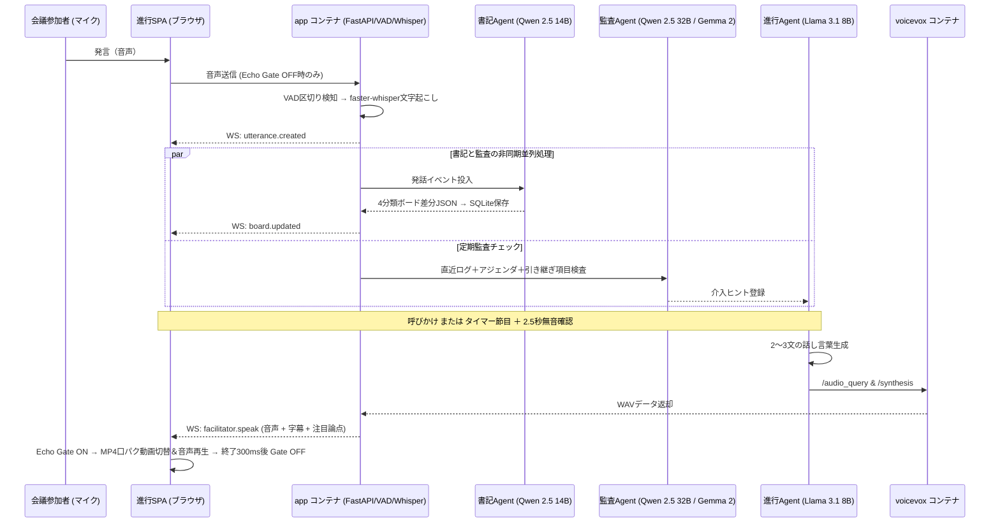
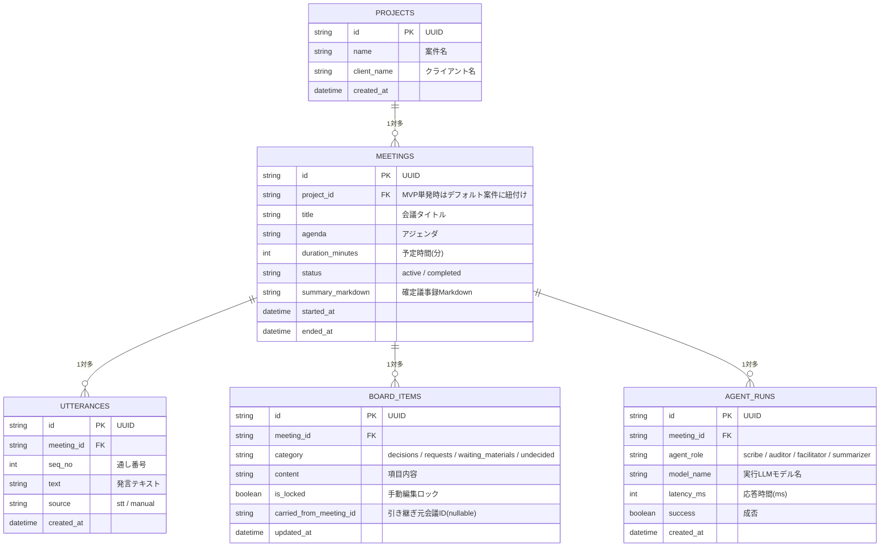

# AI会議ファシリテーターシステム 技術要件定義書（Docker・簡易認証・MVP対応版）

## 1. システムアーキテクチャ

### 1.1 コンテナ＆ネットワーク全体構成
どのPC（Mac / Windows WSL2 / 一般Linux / 本番GB10 `aarch64`）でも `docker compose up` で再現できるよう、アプリケーションと音声合成エンジンをDockerコンテナ化し、永続データ（SQLite・設定）をホストボリュームにマウントする。

```mermaid
flowchart TD
    subgraph Room["対面会議室 (同席端末 / モニター)"]
        MicSpk["会議用マイクスピーカー (AEC搭載)"]
        RoomUI["会議進行SPA (Vite + TypeScript)<br/>パスコード認証済セッション"]
    end

    subgraph OfficeLAN["社内LAN"]
        ViewerUI["社内メンバーPCブラウザ<br/>パスコード認証 → 案件・過去議事録閲覧"]
    end

    subgraph DockerHost["実行ホストPC (GB10 Linux arm64 / 開発Mac 等)"]
        subgraph DockerNet["Docker Compose Network"]
            AppContainer["app コンテナ (Python 3.11 + FastAPI)<br/>・認証ミドルウェア (簡易パスワード)<br/>・静的ビルド済SPA配信<br/>・Silero VAD + faster-whisper<br/>・並列AIエージェント群 (MVPでは単一→v0.5で3並列)"]
            VVContainer["voicevox コンテナ<br/>VOICEVOX Engine (Multi-arch / arm64対応)"]
        end

        DataVol[("./data マウントボリューム<br/>SQLite (WAL) / 議事録エクスポート")]
        OllamaSvc["Ollama 推論基盤 (ホスト常駐 または GPUコンテナ)<br/>Llama 3.1 / Qwen 2.5 / Gemma 2"]
    end

    MicSpk <-->|音声入出力| RoomUI
    RoomUI <-->|HTTP + WebSocket (Cookie/Token認証)| AppContainer
    ViewerUI <-->|HTTP REST API (Cookie/Token認証)| AppContainer
    AppContainer <-->|HTTP:50021| VVContainer
    AppContainer <-->|OLLAMA_BASE_URL| OllamaSvc
    AppContainer <--> DataVol
```

### 1.2 Docker構成要件（ポータビリティ仕様）
1. **マルチアーキテクチャ対応**：`Dockerfile` のベースイメージには `python:3.11-slim` 等の `linux/amd64`・`linux/arm64` 両対応公式イメージを使用し、ネイティブ依存を最小化する。
2. **2段構えのComposeファイル**：
   * `compose.yaml`（標準構成）：GPUパススルー設定を持たず、MacやGPUなしPCでもそのまま `docker compose up --build` で起動可能。Whisperは `WHISPER_DEVICE=cpu`（`small` / `base` モデル）、Ollamaは `http://host.docker.internal:11434`（未接続時はデモモード可）を参照。
   * `compose.gpu.yaml`（GB10 / NVIDIA Linux用オーバーライド）：`deploy.resources.reservations.devices` でNVIDIA GPUを割り当て、`WHISPER_DEVICE=cuda`（`large-v3-turbo` モデル）を有効化する。
3. **環境変数テンプレート管理**：リポジトリには機密を含まない `.env.example` を同梱し、実行環境ごとの差分（パスコード、Ollama接続先、モデル名）は環境変数で注入する。

---

## 2. マルチエージェント ＆ 複数LLMモデル仕様

### 2.1 段階的アーキテクチャ進化（MVP → Beta v0.5）
* **MVP (v0.1)**：`Facilitator` と `Scribe` のプロンプトを単一モデル（例：`llama3.1:8b`）で順次実行し、最小構成でエンドツーエンド動作を成立させる。
* **Beta (v0.5以降)**：同一インターフェースのまま非同期イベントキューを有効化し、以下の複数LLMモデルへ並列ディスパッチする。

| エージェント識別子 | 役割・責務 | 起動トリガー | 採用モデル（GB10本番） | 軽量PC実行時の代替例 |
| :--- | :--- | :--- | :--- | :--- |
| **`scribe`**<br>（書記役） | 発言ログと既存ボードから「決定事項・要望・素材待ち・未決定事項」の差分JSONを抽出・DB更新 | 新規発話確定ごと（デバウンス制御） | `qwen2.5:14b` | `llama3.1:8b` |
| **`auditor`**<br>（抜け漏れ監査役） | アジェンダ未消化、期限・担当曖昧な宿題、引き継ぎ課題の放置を検知し進行役へヒント通知 | 発話5件ごと / 3分周期 | `qwen2.5:32b` または `gemma2:27b` | `llama3.1:8b` |
| **`facilitator`**<br>（進行役） | 質問応答や監査ヒントをもとに、音声読み上げ用の自然な話し言葉（記号なし・120字以内）を生成 | ①手動/音声呼びかけ<br>②残り時間節目＋無音検知 | `llama3.1:8b` または `gemma2:9b` | `llama3.1:8b` |
| **`summarizer`**<br>（まとめ役） | 会議終了時の口頭総括、ネクストアクション抽出、確定Markdown生成、次回持ち越し項目確定 | 会議終了ボタン押下時 | `qwen2.5:32b` | `llama3.1:8b` |

### 2.2 会議中の並列協調シーケンス（v0.5〜v1.0 完成形）



---

## 3. 機能要件（Functional Requirements）

### FR-00：簡易パスワード認証機能（社内LAN保護）
1. **共有パスコード認証**：環境変数 `APP_PASSCODE` で設定した簡易パスワード（PIN／パスフレーズ）の入力画面を提供すること。
2. **セッション維持と保護**：認証成功時に署名付き `HttpOnly` Cookie（`SameSite=Lax`）を発行し、未認証クライアントからの全REST API（`/api/auth/*` とヘルスチェックを除く）およびWebSocket接続を `401 Unauthorized` で拒否すること。
3. **定数時間比較**：パスコード照合には `hmac.compare_digest` を用い、タイミング攻撃を防止すること。

### FR-01：案件管理・過去会議からの引き継ぎ機能 *(MVPでは単発会議保存→v1.0で案件引き継ぎ完成)*
1. **案件・会議階層管理**：顧客・案件単位で複数回の会議を紐付けてSQLiteに保存できること。
2. **未解決項目の自動引き継ぎ（Carry-over）**：同一案件で新規会議を開始する際、前回会議の未解決項目（「素材待ち」「未決定事項」）を初期ボードへ自動コピーし、「前回からの持ち越し」バッジを表示すること。
3. **社内LAN閲覧**：別PCからパスコード認証後に過去議事録・ネクストアクション・残課題一覧を検索・閲覧できること。

### FR-02：対面会議室オーディオ取り込み・自己エコー抑止機能 *(MVPではボタン録音→v0.5で連続VAD化)*
1. **ローカル文字起こし**：ブラウザから送信された音声データを `faster-whisper` でローカル文字起こしすること（MVPではPush-to-Talk録音で確実に動かし、v0.5で `Silero VAD` による自動発話区切りへ拡張）。
2. **自己音声エコー抑止（Self-Voice Gate）**：VOICEVOX音声の再生中および再生終了後 `300ms` はマイク入力を遮断し、AI自身の声を文字起こししないこと。
3. **テキスト併用**：音声認識と並行してキーボードからの発言入力・修正も行えること。

### FR-03：リアルタイム議事ボード ＆ 手動ロック機能
1. **4分類構造化**：「決定事項 (`decisions`)」「クライアント要望 (`requests`)」「素材待ち (`waiting_materials`)」「未決定事項 (`undecided`)」に自動整理してリアルタイム表示すること。
2. **手動編集ロック（`is_locked`）**：人間が画面上で修正・移動・追加した項目にはロックフラグを付与し、AIの次回自動更新時に上書き・削除されないようにすること。

### FR-04：ファシリテーション介入 ＆ まとめ出力機能
1. **オンデマンド＆タイマー声かけ**：「AIに声をかける」ボタンおよび残り時間チェックに応じ、未決定事項の整理や時間配分をVOICEVOX音声＋アバター映像で案内すること。
2. **会議終了まとめ**：終了操作で口頭総括の読み上げ、ネクストアクション抽出、Markdown議事録のダウンロード／コピー、およびDBへの確定保存を行うこと。

### FR-05：アバター映像・音声レンダラー抽象化仕様
Phase 1（MP4ループ動画：`idle.mp4` / `thinking.mp4` / `talk.mp4` 切替、動画未配置時は内蔵SVG口パクへ自動フォールバック）から Phase 2（Live2D / 3D VRM）へ無改修で差し替えられるよう、フロントエンドの描画層を `AvatarRenderer` インターフェースで分離する。

```typescript
export type AvatarState = "idle" | "listening" | "thinking" | "speaking";

export interface AvatarRenderer {
  mount(container: HTMLElement): Promise<void>;
  setState(state: AvatarState): void;
  bindAudioSource?(audioContext: AudioContext, sourceNode: AudioNode): void;
  dispose(): void;
}
```

---

## 4. データベース設計（SQLite）

SQLiteファイルはDockerボリューム `./data/app.db` に配置し、起動時に `PRAGMA journal_mode=WAL;` と `PRAGMA foreign_keys=ON;` を設定する。



---

## 5. インターフェース仕様（REST API ＆ WebSocket）

### 5.1 主要REST APIエンドポイント

| メソッド | パス | 用途 | MVP (v0.1) 対象 |
| :--- | :--- | :--- | :---: |
| `POST` | `/api/auth/login` | 簡易パスワード照合・認証Cookie発行 | **○** |
| `POST` | `/api/auth/logout` | ログアウト（Cookie破棄） | **○** |
| `GET` | `/api/health` | Ollama・VOICEVOX・Whisperの接続状態確認 | **○** |
| `POST / GET` | `/api/meetings` / `/api/meetings/{id}` | 会議の作成・状態取得・履歴一覧取得 | **○** |
| `POST` | `/api/meetings/{id}/audio` | 録音音声アップロード → Whisper文字起こし＆ボード更新（MVP用） | **○** |
| `POST` | `/api/meetings/{id}/utterances` | テキスト発言追加 → ボード更新 | **○** |
| `POST` | `/api/meetings/{id}/facilitate` | 進行役AIの声かけ生成 ＋ VOICEVOX音声URL返却 | **○** |
| `POST` | `/api/meetings/{id}/summarize` | 会議終了・総括音声生成・Markdown確定保存 | **○** |
| `PATCH / POST` | `/api/meetings/{id}/board-items` | ボード手動編集・ロック（`is_locked=true`） | v0.5 |
| `GET / POST` | `/api/projects` / `/api/projects/{id}/carryover` | 案件管理・前回未解決項目の引き継ぎ取得 | v1.0 |
| `GET / PUT` | `/api/settings/models` | エージェント別LLMモデル割当の参照・変更 | v0.5 |

### 5.2 WebSocket仕様（`/ws/meetings/{meeting_id}`）
* 接続時に認証Cookieを検証し、未認証時は即時クローズ（Close Code `1008`）する。
* MVP（v0.1）ではボード・アバター状態のリアルタイム通知に使用し、Beta（v0.5）から連続VAD用のPCM音声ストリーム送受信を追加する。

---

## 6. 推奨ディレクトリ構成（Docker対応モノレポ）

```text
meeting-facilitator-ai/
├── compose.yaml                 # 全PC共通 Docker Compose 定義 (Mac / 一般PC / GB10共通)
├── compose.gpu.yaml             # GB10 (NVIDIA GPU) 用オーバーライド定義
├── Dockerfile                   # マルチステージビルド (Frontend build -> FastAPI + Whisper)
├── .env.example                 # 環境変数テンプレート (APP_PASSCODE, OLLAMA_BASE_URL 等)
├── docs/
│   ├── project-plan.md          # 開発計画書
│   └── requirements.md          # 技術要件定義書
├── config/
│   └── models.yaml              # エージェント別LLMモデル設定
├── data/                        # SQLite DB・生成音声キャッシュ永続化先 (.gitignore対象)
├── backend/
│   ├── requirements.txt
│   ├── main.py                  # FastAPI エントリポイント
│   ├── auth.py                  # 簡易パスワード認証ミドルウェア
│   ├── db/                      # SQLite (WAL) スキーマ・リポジトリ
│   ├── audio/                   # faster-whisper / Silero VAD / VOICEVOX 連携
│   └── agents/                  # Scribe / Auditor / Facilitator / Summarizer
└── frontend/                    # Vite + TypeScript SPA
    ├── package.json
    ├── src/
    │   ├── avatar/              # AvatarRenderer インターフェース & ループ動画/SVG実装
    │   ├── components/          # ログイン画面 / 会議進行画面 / 過去議事録一覧
    │   └── api/                 # REST & WebSocket クライアント
    └── public/videos/           # idle.mp4 / thinking.mp4 / talk.mp4
```
